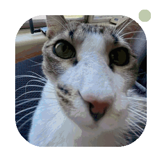

<div align="center">


### I build, automate, and observe the systems behind the interesting stuff.

[](https://gctf.dev)
[](https://azmsh.net)
[](https://github.com/ArizonaMeshtasticCommunity)

<br><br>


<sub>on-call infrastructure supervisor</sub>

</div>

```text
$ whoami
Logan — infrastructure builder, self-hoster, and automation enthusiast.

$ systemctl status household-cats
● household-cats.service — Active: active (running)
  └─ supervising containers and sitting on the warmest keyboard
```

## What I work on

- Self-hosted services that remain useful when the cloud—or the internet—is unavailable
- Containers, deployment automation, reverse proxies, and the glue between services
- Metrics, dashboards, time-series data, and tools that make complex systems observable
- Community infrastructure for the [Arizona Meshtastic Community](https://github.com/ArizonaMeshtasticCommunity)
- Radio, embedded systems, and old hardware when the project calls for something weird

## Systems I keep alive

<table>
  <tr>
    <td width="50%" valign="top">
      <h3><a href="https://github.com/ArizonaMeshtasticCommunity/sonoran">Sonoran</a></h3>
      <p>Infrastructure and observability for the Arizona mesh: MQTT ingest, TimescaleDB storage, APIs, scheduled jobs, maps, graphs, and RF coverage analysis.</p>
      <p><code>Python</code> <code>Docker Compose</code> <code>TimescaleDB</code> <code>MQTT</code></p>
    </td>
    <td width="50%" valign="top">
      <h3><a href="https://github.com/logans-stuff/prusa-disconnect">PrusaDisconnect</a></h3>
      <p>A self-hosted, LAN-only control plane for Prusa printers—with live telemetry and no cloud dependency.</p>
      <p><code>FastAPI</code> <code>WebSocket</code> <code>SQLite</code> <code>Docker</code></p>
    </td>
  </tr>
  <tr>
    <td width="50%" valign="top">
      <h3><a href="https://github.com/logans-stuff/az-meshtastic-metrics-exporter">Meshtastic Metrics</a></h3>
      <p>A telemetry pipeline from MQTT into PostgreSQL/TimescaleDB, with ready-to-use Grafana dashboards.</p>
      <p><code>Grafana</code> <code>PostgreSQL</code> <code>Time series</code> <code>MQTT</code></p>
    </td>
    <td width="50%" valign="top">
      <h3><a href="https://github.com/logans-stuff/caddyshortener">CaddyShortener</a></h3>
      <p>A small piece of useful infrastructure: Discord-managed short URLs backed directly by Caddy's admin API.</p>
      <p><code>Caddy</code> <code>Docker</code> <code>Python</code> <code>Discord</code></p>
    </td>
  </tr>
</table>

## Infrastructure toolbox

<div align="center">


</div>

## Radio lab

Radio is one of the more interesting workloads I build infrastructure around—and occasionally the infrastructure ends up running on a Nintendo Wii.

- **[DualMesh](https://github.com/logans-stuff/dualmesh)** — Android messaging across Meshtastic and MeshCore radios
- **[Meshtastic on Wii](https://github.com/logans-stuff/wii-meshtastic)** — real Meshtastic firmware, native Wii UI, USB LoRa radio
- **[Arizona Meshtastic projects](https://github.com/ArizonaMeshtasticCommunity)** — dashboards, bots, documentation, scripts, and education

## Uptime

<div align="center">


```text
 /\_/\\
( o.o )   all systems nominal
 > ^ <
```

</div>

