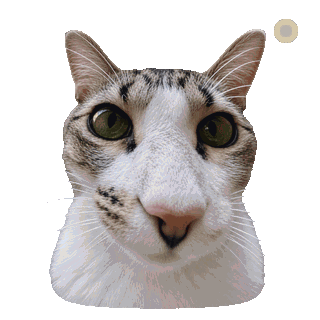

<div align="center">


### Infrastructure, self-hosting, observability, and automation.

[](https://gctf.dev)
[](https://azmsh.net)
[](https://github.com/ArizonaMeshtasticCommunity)

<br><br>


<sub>cat-ops: active</sub>

</div>

```text
$ whoami
Logan

$ systemctl status household-cats
● household-cats.service - active (running)
```

## Focus

- Linux, Docker Compose, Caddy, and self-hosted services
- PostgreSQL, TimescaleDB, MQTT, and data pipelines
- Grafana, metrics, dashboards, and service monitoring
- Community infrastructure for the [Arizona Meshtastic Community](https://github.com/ArizonaMeshtasticCommunity)

## Projects

<table>
  <tr>
    <td width="50%" valign="top">
      <h3><a href="https://github.com/ArizonaMeshtasticCommunity/sonoran">Sonoran</a></h3>
      <p>Arizona mesh observability stack with MQTT ingest, TimescaleDB storage, read-only APIs, scheduled jobs, maps, topology graphs, and RF coverage analysis.</p>
      <p><code>Python</code> <code>Docker Compose</code> <code>TimescaleDB</code> <code>MQTT</code></p>
    </td>
    <td width="50%" valign="top">
      <h3><a href="https://github.com/logans-stuff/prusa-disconnect">PrusaDisconnect</a></h3>
      <p>LAN-only management service for Prusa printers with telemetry, WebSocket updates, file operations, and SQLite persistence.</p>
      <p><code>FastAPI</code> <code>WebSocket</code> <code>SQLite</code> <code>Docker</code></p>
    </td>
  </tr>
  <tr>
    <td width="50%" valign="top">
      <h3><a href="https://github.com/logans-stuff/az-meshtastic-metrics-exporter">Meshtastic Metrics</a></h3>
      <p>MQTT telemetry ingestion into PostgreSQL and TimescaleDB with Grafana dashboards.</p>
      <p><code>Grafana</code> <code>PostgreSQL</code> <code>Time series</code> <code>MQTT</code></p>
    </td>
    <td width="50%" valign="top">
      <h3><a href="https://github.com/logans-stuff/caddyshortener">CaddyShortener</a></h3>
      <p>Discord-managed short URLs backed by the Caddy admin API and isolated Docker networking.</p>
      <p><code>Caddy</code> <code>Docker</code> <code>Python</code> <code>Discord</code></p>
    </td>
  </tr>
</table>

## Radio and embedded projects

- **[DualMesh](https://github.com/logans-stuff/dualmesh)** - Android client for Meshtastic and MeshCore radios
- **[Meshtastic on Wii](https://github.com/logans-stuff/wii-meshtastic)** - Meshtastic firmware port using libogc, a Wii UI, and a USB LoRa radio
- **[Arizona Meshtastic projects](https://github.com/ArizonaMeshtasticCommunity)** - monitoring, bots, documentation, scripts, and training material

## GitHub activity

<div align="center">


</div>

